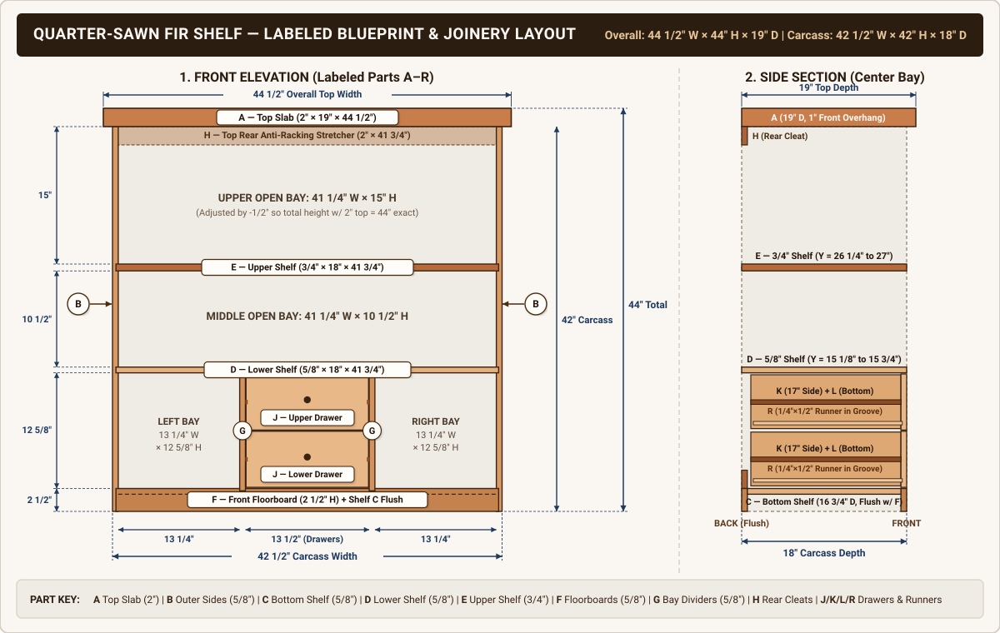

# Quarter-Sawn Fir Shelf — Master Cut List & Labeled Shop Plan

---

## 1. Finished & Carcass Dimensions Summary

| Dimension | Carcass (Box Only) | Overall (With `2"` Top Installed) | Notes |
| :--- | :--- | :--- | :--- |
| **Width** | `42 1/2"` (`42.500"`) | **`44 1/2"`** (`44.500"`) | `1"` overhang on left and right sides |
| **Height** | `42"` (`42.000"`) | **`44"`** (`44.000"`) | Adjusted top opening to `15"` so total height is `44"` exact |
| **Depth** | `18"` (`18.000"`) | **`19"`** (`19.000"`) | `1"` overhang at front, flush at back |

### Vertical Height Stack-Up (Bottom to Top)
1. **Front & Rear Floorboards (`F`) + Flush Bottom Shelf (`C`):** `0"` to **`2 1/2"`** (`2.500"`)
2. **Lower 3-Quadrant Bay Opening (with 2 Center Drawers):** `2 1/2"` to `15 1/8"` (**`12 5/8"`** high)
3. **Lower Full-Width Shelf (`D`, `5/8"` thick):** `15 1/8"` to **`15 3/4"`** (`0.625"` thick)
4. **Middle Full-Width Open Bay:** `15 3/4"` to `26 1/4"` (**`10 1/2"`** high)
5. **Upper Full-Width Shelf (`E`, `3/4"` thick):** `26 1/4"` to **`27"`** (`0.750"` thick for zero sag)
6. **Upper Full-Width Open Bay:** `27"` to **`42"`** (**`15"`** high)
7. **Overhanging Top Slab (`A`, `2"` thick):** `42"` to **`44"`** (**`2"`** thick)

---

## 2. Master Cut List (All Parts Labeled `A`–`R`)

> [!IMPORTANT]
> **Dado Allowance Included:** All shelf lengths (`C`, `D`, `E`, `F`, `H1`) include an extra **`1/2"`** (`1/4"` on each end) to seat into the `1/4"` deep dados in the Left & Right Side Panels (`B`). Similarly, the Vertical Dividers (`G`) include an extra **`1/2"`** (`1/4"` top and bottom) to seat into Shelves `C` and `D`.

### Carcass & Top (`2"`, `3/4"`, and `5/8"` Quarter-Sawn Fir)

| Part ID | Part Name | Qty | Thickness (T) | Width (W) | Cut Length (L) | Decimal (T × W × L) | Where It Goes & Joinery Notes |
| :---: | :--- | :---: | :---: | :---: | :---: | :---: | :--- |
| **`A`** | **Top Slab** | 1 | `2"` | `19"` | `44 1/2"` | `2.000" × 19.000" × 44.500"` | Sits on top of carcass (`42"`). Overhangs front & sides by `1"`, flush at back. Attach with figure-8 fasteners or elongated screw holes through `H1`. |
| **`B`** | **Outer Side Panels** *(Left & Right)* | 2 | `5/8"` | `18"` | `42"` | `0.625" × 18.000" × 42.000"` | Left and right outer walls. Route `1/4"` deep cross-dados on inside faces for `C`, `D`, `E`, and stopped/vertical grooves for `F` & `H1`. |
| **`C`** | **Bottom Shelf** *(Flush w/ Floorboard)* | 1 | `5/8"` | `16 3/4"` | `41 3/4"` | `0.625" × 16.750" × 41.750"` | Sits between Front & Rear Floorboards (`F`) from `1 7/8"` to `2 1/2"` height so its top face is dead flush with the top of `F`. Route two `1/4"` dados on top face for `G`. |
| **`D`** | **Lower Full Shelf** *(Above 3 Bays)* | 1 | `5/8"` | `18"` | `41 3/4"` | `0.625" × 18.000" × 41.750"` | Separates the `12 5/8"` 3-bay section from the `10 1/2"` middle section. Route two `1/4"` dados on its **underside** for dividers `G`. |
| **`E`** | **Upper Full Shelf** *(Heavy-Duty `3/4"`)* | 1 | **`3/4"`** | `18"` | `41 3/4"` | `0.750" × 18.000" × 41.750"` | Separates the `10 1/2"` middle bay from the `15"` top bay. Milled to `3/4"` to prevent sag across the `41 1/4"` open span. |
| **`F`** | **Front & Rear Floorboards** | 2 | `5/8"` | `2 1/2"` | `41 3/4"` | `0.625" × 2.500" × 41.750"` | One at bottom front, one matching at bottom back (locks the open-back base against racking). Top edge is flush with top of Shelf `C` at `2 1/2"`. |
| **`G`** | **Lower Vertical Bay Dividers** | 2 | `5/8"` | `18"` | `13 1/8"` | `0.625" × 18.000" × 13.125"` | Divides lower `12 5/8"` bay into three sections: **`13 1/4"` Left**, **`13 1/2"` Center (Drawers)**, and **`13 1/4"` Right**. |
| **`H1`** | **Top Rear Anti-Racking Cleat** | 1 | `5/8"` | `2"` | `41 3/4"` | `0.625" × 2.000" × 41.750"` | Mounted flush at the top back of the `15"` upper bay (right under Top `A`) to prevent side-to-side wobble and anchor Top `A`. |
| **`H2`** | **Rear Drawer Stop Stretcher** | 1 | `5/8"` | `2"` | `13 1/2"` | `0.625" × 2.000" × 13.500"` | Mounted at the back of the `13 1/2"` center bay on Shelf `C` so both drawers stop flush with the front face. |

---

### Center Bay Drawers & Shop-Made Runners (Builds 2 Drawers)

> [!TIP]
> **How the Shop-Made Runner System Works (`1/4" × 1/2"` Runner `R`):**
> Each runner (`R`) is **`1/4"` thick × `1/2"` tall × `17"` long** and is glued/screwed to the inside face of Vertical Dividers `G`.
> Each Drawer Side (`K`, `5/8"` thick) has a **`1/4"` deep × `17/32"` wide groove** plowed down the center of its outside face. When installed, `3/16"` of the runner rides inside the drawer groove and `1/16"` spaces the drawer box off the divider wall—giving smooth action and allowing your inset drawer front (`J1`) to be the exact same width (`13 3/8"`) as the drawer box!

| Part ID | Part Name | Qty | Thickness (T) | Width / Height (W) | Cut Length (L) | Decimal (T × W × L) | Where It Goes & Joinery Notes |
| :---: | :--- | :---: | :---: | :---: | :---: | :---: | :--- |
| **`J1`** | **Inset Drawer Fronts** | 2 | `5/8"` | `6 1/8"` | `13 3/8"` | `0.625" × 6.125" × 13.375"` | Front faces of Upper & Lower drawers. Gives a uniform `1/8"` reveal (penny gap) at top, middle, and bottom (`6 1/8" + 6 1/8" + 3×(1/8") = 12 5/8"`). Cut `3/8"` wide × `3/8"` deep rabbets on inside ends to receive sides `K`. |
| **`J2`** | **Drawer Backs** | 2 | `5/8"` | `5 3/8"` | `12 5/8"` | `0.625" × 5.375" × 12.625"` | Rear walls of Upper & Lower drawer boxes. Captures `1/4"` into dados near the rear of Drawer Sides `K`, sitting above Bottom `L`. |
| **`K`** | **Grooved Drawer Sides** | 4 | `5/8"` | `5 7/8"` | `17"` | `0.625" × 5.875" × 17.000"` | Left & right sides for both drawers. Plow a **`1/4"` deep × `17/32"` wide groove** along the outside face (centered `2 11/16"` up from bottom edge) for Runner `R`. |
| **`L`** | **Drawer Bottom Panels** | 2 | `3/8"` | `12 5/8"` | `16 1/4"` | `0.375" × 12.625" × 16.250"` | Resawn `3/8"` fir (or plywood) captured in `1/4"` deep × `3/8"` wide grooves cut `3/8"` up from the bottom inside edges of `J1` and `K`. |
| **`R`** | **Shop-Made Drawer Runners** | 4 | `1/4"` | `1/2"` | `17"` | `0.250" × 0.500" × 17.000"` | Straight-grain quarter-sawn fir or hardwood strips. Mount inside Dividers `G`: lower pair bottom edge at **`5 5/16"`** from floor (`2 13/16"` above Shelf `C`); upper pair bottom edge at **`11 9/16"`** from floor (`9 1/16"` above Shelf `C`). |

---

## 3. Router Dado Layout Guide (Where to Cut Each Groove)

Use this checklist when laying out your `1/4"` deep dados so every piece lines up on assembly:

### A. Inside Faces of Left & Right Side Panels (`B` — Measure up from Bottom Edge = `0"`)
* **Front & Rear Floorboard Dado (`F`):** `0"` to `2 1/2"` height along the front `5/8"` edge and back `5/8"` edge (`1/4"` deep × `5/8"` wide).
* **Bottom Shelf Dado (`C`):** **`1 7/8"` to `2 1/2"`** from the bottom edge (`1/4"` deep × `5/8"` wide, running between front and rear floorboards).
* **Lower Full Shelf Dado (`D`):** **`15 1/8"` to `15 3/4"`** from the bottom edge (`1/4"` deep × `5/8"` wide, full `18"` width).
* **Upper Full Shelf Dado (`E`):** **`26 1/4"` to `27"`** from the bottom edge (`1/4"` deep × **`3/4"` wide**, full `18"` width).

### B. Top of Bottom Shelf (`C`) & Underside of Lower Shelf (`D` — Measure in from Left End of Board)
*(Remember: `1/4"` of each end of `C` and `D` seats inside Side Panels `B`)*
* **Left Vertical Divider Dado (`G`):** **`13 1/2"` to `14 1/8"`** from the left end of the shelf (`1/4"` deep × `5/8"` wide). *(Leaves `13 1/4"` clear left bay).*
* **Right Vertical Divider Dado (`G`):** **`27 5/8"` to `28 1/4"`** from the left end of the shelf (`1/4"` deep × `5/8"` wide). *(Leaves `13 1/2"` clear center drawer bay and `13 1/4"` clear right bay).*

---

## 4. Recommended Shop Assembly Order

1. **Dry-Fit Sub-Assembly First:** Cut the dados in `B`, `C`, and `D`. Before gluing the outer case, glue and screw the four **Drawer Runners (`R`)** onto the inside faces of the two **Vertical Dividers (`G`)**—it is much easier to measure and clamp them flat on your workbench than inside the assembled cabinet.
2. **Assemble the Lower Core (`C + G + D`):** Glue the two **Vertical Dividers (`G`)** between the **Bottom Shelf (`C`)** and **Lower Full Shelf (`D`)**, checking that the center bay is square (`13 1/2"` W × `12 5/8"` H).
3. **Bring the Sides Together (`B + E + F + H`):** Lay one **Side Panel (`B`)** flat on the bench, glue in the `C/G/D` assembly, the `3/4"` **Upper Shelf (`E`)**, the **Front & Rear Floorboards (`F`)**, and the **Rear Cleats (`H1`, `H2`)**, then cap with the second **Side Panel (`B`)** and clamp square.
4. **Attach Top (`A`) & Fit Drawers (`J/K/L`):** Fasten the `2"` **Top Slab (`A`)** flush at the back with a `1"` overhang on the front and sides. Build the two drawer boxes (`J1`, `J2`, `K`, `L`), wax the wooden runners (`R`) with paste wax or paraffin, and slide the drawers home!

